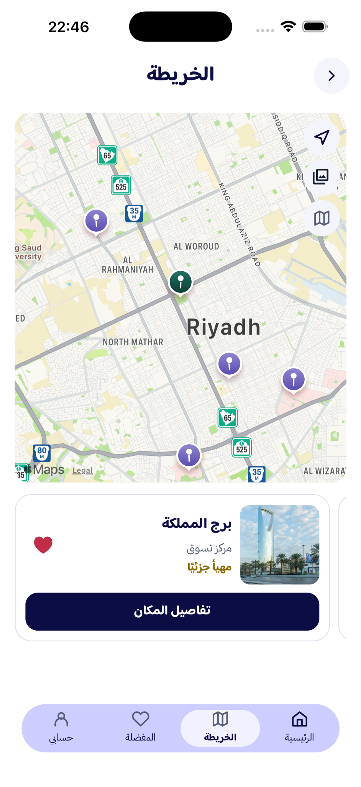
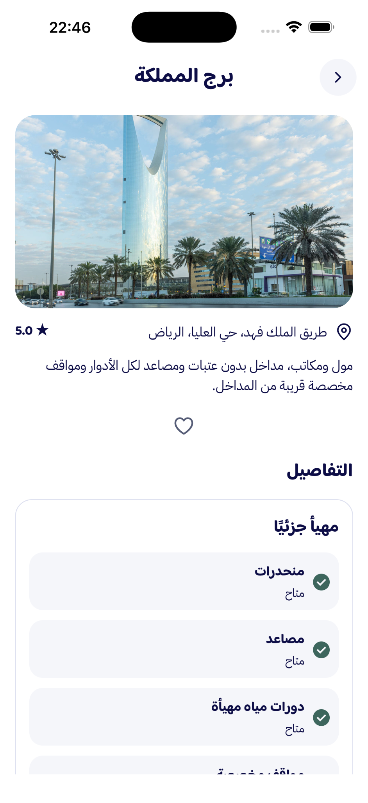
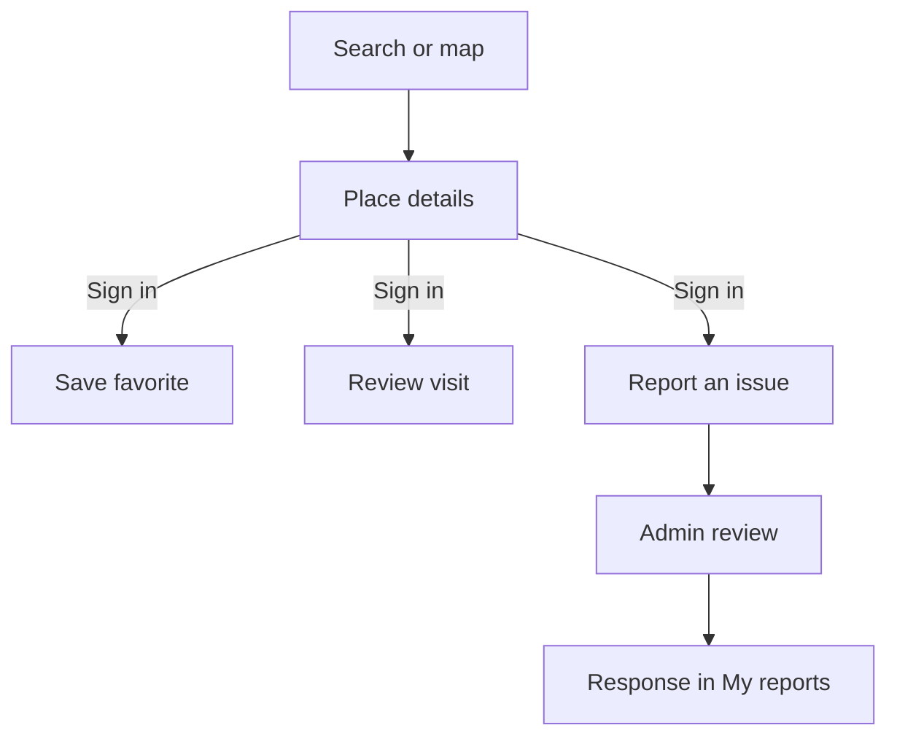

<p align="center"></p>

# AOUN

**لك في كل مكان عون**

[العربية](README.md) · [English](README.en.md)

[Repository structure](#repository) · [Technology stack](#stack) · [Run locally](#run)

**AOUN is an Arabic-first accessibility guide to public places in Riyadh**, built as a software engineering project at King Saud University for people with disabilities, older adults and their companions.

Imagine planning a visit to Kingdom Centre with someone who uses a wheelchair. You know the address. What you still need to know is whether there is a step-free entrance and a lift. AOUN lets you filter for those facilities, find the place on a map and check its access details before deciding to go.

## From search to a visit

| Filter by facility | Explore the map | Kingdom Centre details |
|---|---|---|
|  |  |  |

In the Kingdom Centre example, **partially accessible** has a concrete meaning. The listing records accessible entrances and lifts as available, and Braille signs as unavailable. After a visit, a member can share what they experienced or flag a listing that needs correcting.

<a id="repository"></a>

## Repository structure

The tree highlights the main working paths. To trace a search, start at the [filter screen](mobile/app/filters.tsx), inspect how the [places client](mobile/services/places.ts) builds its request, then follow the handler in [FastAPI](backend/main.py). The [Supabase migrations](supabase/migrations/) define the schema and permissions.

```text
AOUN-APP/
├── mobile/
│   ├── app/
│   │   ├── home.tsx
│   │   ├── filters.tsx
│   │   ├── nearby.tsx
│   │   ├── live-places/[id].tsx
│   │   └── admin/
│   ├── services/
│   │   ├── places.ts
│   │   ├── reports.ts
│   │   └── supabase.ts
│   ├── auth/
│   ├── ui/
│   ├── theme/
│   ├── assets/
│   └── tests/
├── backend/
│   ├── main.py
│   ├── review_photos.py
│   ├── review_photo_cleanup.py
│   └── tests/
├── supabase/
│   ├── migrations/
│   ├── seed.sql
│   └── tests/
├── docs/
│   ├── api.md
│   ├── database.md
│   └── screens/
├── .github/workflows/
├── README.md
└── README.en.md
```

## Who uses AOUN?

- **Guests** browse in Arabic or English, search by name or facility and open the same place details from a list or map.
- **Members** save favorites and share an access rating, a comment and photos. From their account they can edit or delete a review and follow their reports and the moderator’s response.
- **Administrators** manage places and accounts and moderate reviews and reports. Closing a report records the resolution or reason for rejection for its author.



<a id="stack"></a>

## Technology stack

| Layer | Tools | Responsibility |
|---|---|---|
| Mobile app | React Native · TypeScript · Expo SDK 54 · Expo Router | Screens, navigation and a shared place detail view for search and map results. |
| Maps and location | Expo Location · react-native-maps · Leaflet | Device location and place markers on mobile and web. |
| Place and photo API | Python · FastAPI · Uvicorn · Pillow | Place queries, review photo validation and signed access to private images. |
| Accounts and storage | Supabase Auth · PostgreSQL · Supabase Storage | Sign-in, favorites, reviews, reports, photos and member/admin permissions. |

<a id="run"></a>

## Run locally

Use Python 3.12 and Node.js 22.13 or later in the 22.x line. Start each terminal at the repository root.
```bash
cp -n backend/.env.example backend/.env
cp -n mobile/.env.example mobile/.env
```

Prepare a development Supabase project and apply the [migrations](supabase/migrations/) in order. Set the project URL and publishable key in both environment files for the same project. In the mobile file, set `EXPO_PUBLIC_API_URL` to `http://127.0.0.1:8000` for the iOS simulator. For private review photos, configure `SUPABASE_REVIEW_PHOTO_SECRET_KEY` and `REVIEW_PHOTO_VALIDATION_KEY` in the backend environment only. See [auth and recovery redirects](docs/auth-admin.md).

**Terminal 1 · Backend**

```bash
cd backend
python3.12 -m venv .venv
.venv/bin/python -m pip install -r requirements.txt
.venv/bin/python -m uvicorn main:app --reload --port 8000
```

**Terminal 2 · iOS simulator on macOS**

```bash
cd mobile
npm ci
npx expo start --go --ios
```

Use an SDK 54-compatible Expo Go client on the simulator. Try the [place list](http://127.0.0.1:8000/places) or explore the [local API docs](http://127.0.0.1:8000/docs).

## Checks and documentation

```bash
(cd mobile && npm run typecheck && node --test tests/*.test.cjs)
(cd backend && .venv/bin/python -m unittest discover -s tests)
```

[Device setup](docs/setup.md) · [Place API](docs/api.md) · [Database](docs/database.md) · [Accounts and administration](docs/auth-admin.md)
