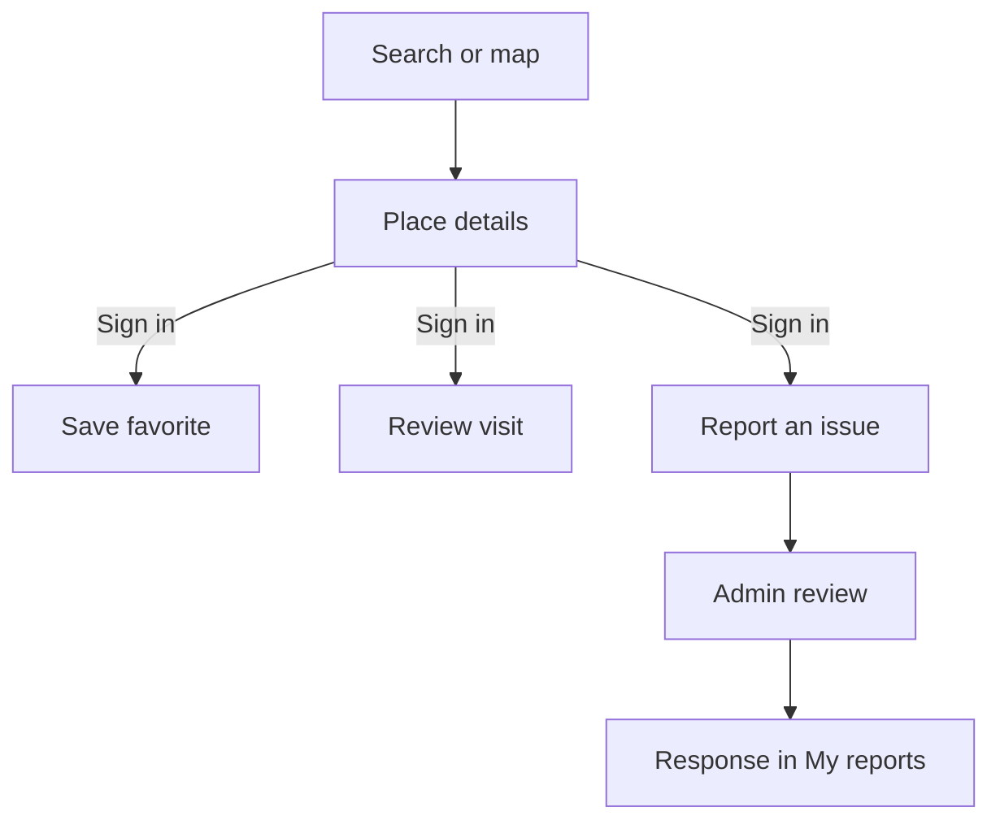

<p align="center"></p>

# AOUN

**لك في كل مكان عون**

[العربية](README.md) · [English](README.en.md)

Can I get in without using stairs? Are there Braille signs inside? **AOUN** helps people with disabilities, older adults and their companions plan visits to public places in Riyadh. Search for the facilities you need, read visitors’ experiences and choose a destination that works for you. AOUN is a software engineering project at King Saud University.

## Before a visit

| Filter by facility | Explore the map | Kingdom Centre details |
|---|---|---|
|  |  |  |

The app lists Kingdom Centre as partially accessible. Open its details to see which facilities are available. The nine filters cover ramps, lifts, accessible restrooms, designated parking, accessible entrances, tactile paths, Braille signs, visual alerts and assistive listening systems.

## Who uses AOUN?

- **Guests** browse in Arabic or English, search by name or facility and open the same place details from a list or map.
- **Members** save favorites and share an access rating, a comment and photos. From their account they can edit or delete a review and follow their reports and the moderator’s response.
- **Administrators** manage places and accounts and moderate reviews and reports. Closing a report records the resolution or reason for rejection for its author.



## How it works

The mobile client uses **React Native, TypeScript and Expo SDK 54**, with **Expo Router** for navigation. Maps use **react-native-maps** on mobile and **Leaflet** on the web, alongside **Expo Location** for positioning. The interface pairs **Baloo Bhaijaan 2** with **IBM Plex Sans Arabic**.

The client requests place data from a **Python FastAPI** service running on **Uvicorn**. It also connects to **Supabase Auth** for accounts and **PostgreSQL** for member and administrator operations. Row-level policies and database functions enforce access. **Supabase Storage** holds images. The backend validates review photos with **Pillow** and signs access to private images.

## Repository guide

- [`mobile/app/`](mobile/app/) — App screens and administrator routes
- [`mobile/services/`](mobile/services/) — API and Supabase clients
- [`mobile/ui/`](mobile/ui/) — Shared forms and UI
- [`mobile/theme/`](mobile/theme/) — Design colors
- [`backend/`](backend/) — Place API and review photo processing
- [`supabase/`](supabase/) — Database config, migrations, seed data and SQL tests
- [`.github/`](.github/) — Continuous integration workflows and fixtures
- [`docs/`](docs/) — Developer guides and screenshots

## Run locally

Use Python 3.12 and Node.js 22.13 or later in the 22.x line. Start each terminal at the repository root.
```bash
cp -n backend/.env.example backend/.env
cp -n mobile/.env.example mobile/.env
```

Prepare a development Supabase project and apply the [migrations](supabase/migrations/) in order. Set the project URL and publishable key in both environment files for the same project. In the mobile file, set `EXPO_PUBLIC_API_URL` to `http://127.0.0.1:8000` for the iOS simulator. For private review photos, configure `SUPABASE_REVIEW_PHOTO_SECRET_KEY` and `REVIEW_PHOTO_VALIDATION_KEY` in the backend environment only. See [auth and recovery redirects](docs/auth-admin.md).

**Terminal 1 · Backend**

```bash
cd backend
python3.12 -m venv .venv
.venv/bin/python -m pip install -r requirements.txt
.venv/bin/python -m uvicorn main:app --reload --port 8000
```

**Terminal 2 · iOS simulator on macOS**

```bash
cd mobile
npm ci
npx expo start --go --ios
```

Use an SDK 54-compatible Expo Go client on the simulator. Try the [place list](http://127.0.0.1:8000/places) or explore the [local API docs](http://127.0.0.1:8000/docs).

## Checks and documentation

```bash
(cd mobile && npm run typecheck && node --test tests/*.test.cjs)
(cd backend && .venv/bin/python -m unittest discover -s tests)
```

[Device setup](docs/setup.md) · [Place API](docs/api.md) · [Database](docs/database.md) · [Accounts and administration](docs/auth-admin.md)
