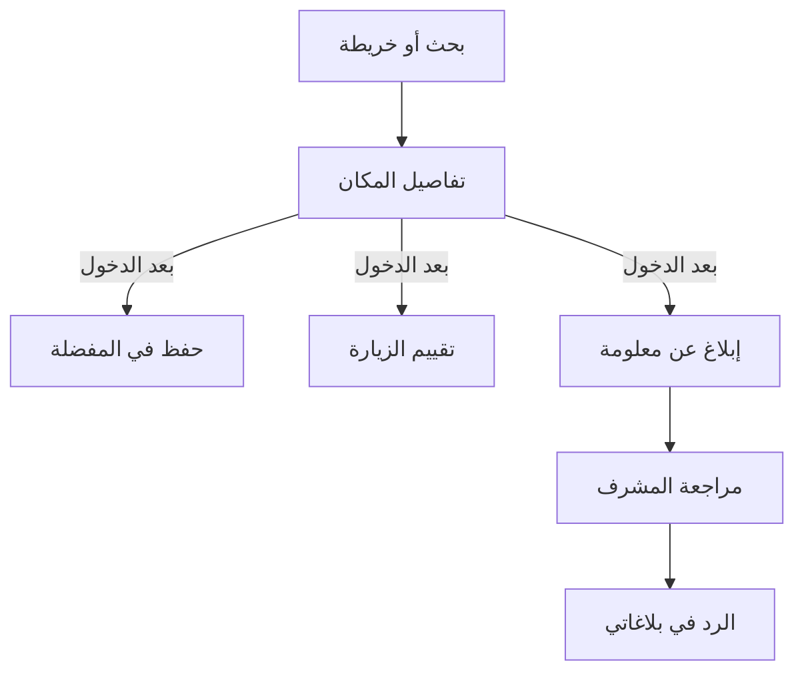

<p align="center"></p>

# عون

**لك في كل مكان عون**

[العربية](README.md) · [English](README.en.md)

هل يمكن دخول المكان دون درج؟ وهل تتوفر فيه لوحات برايل؟ يساعد **عون** الأشخاص ذوي الإعاقة وكبار السن ومرافقيهم على التخطيط لزيارة الأماكن العامة في الرياض. ابحث عن المرافق التي تهمك، واقرأ تجارب الزوار، ثم اختر الوجهة التي تناسبك. طُوّر التطبيق ضمن مشروع هندسة البرمجيات في جامعة الملك سعود.

## قبل الزيارة

| فلترة المرافق | الأماكن على الخريطة | تفاصيل برج المملكة |
|---|---|---|
|  |  |  |

تعرض بطاقة برج المملكة في التطبيق حالة «مهيّأ جزئيًا». افتح التفاصيل لمعرفة ما وراء هذا الوصف. يمكن البحث وفق تسعة مرافق: المنحدرات، المصاعد، دورات المياه المهيّأة، المواقف المخصّصة، المداخل المهيّأة، المسارات الملموسة، لوحات برايل، التنبيهات المرئية والأنظمة السمعية.

## من يستخدم عون؟

- **الزائر** يتصفح الأماكن بالعربية أو الإنجليزية، ويبحث بالاسم أو المرافق، ويفتح صفحة المكان من القائمة أو الخريطة.
- **العضو** يحفظ الأماكن بالقلب، ويوثّق تجربة الوصول بالنجوم والتعليق والصور. من «حسابي» يستطيع تعديل تقييمه أو حذفه ومتابعة بلاغاته وردّ المشرف.
- **المشرف** يدير الأماكن والحسابات ويراجع التقييمات والبلاغات. عند إغلاق بلاغ يكتب الحل أو سبب الرفض ليطّلع عليه صاحبه.



## كيف بُني التطبيق؟

واجهة الجوال مبنية بـ **React Native وTypeScript وExpo SDK 54**، ويتولى **Expo Router** التنقل. تستخدم الخريطة **react-native-maps** على الجوال و**Leaflet** على الويب، مع **Expo Location** لتحديد الموقع. تجمع الواجهة بين خطّي **Baloo Bhaijaan 2** و**IBM Plex Sans Arabic**.

يطلب التطبيق بيانات الأماكن من واجهة **FastAPI** المكتوبة بـ **Python** والمشغّلة عبر **Uvicorn**. تتصل الواجهة أيضًا بـ **Supabase Auth** للحسابات وبـ **PostgreSQL** لعمليات الأعضاء والإدارة. تضبط سياسات الصفوف ودوال قاعدة البيانات الصلاحيات. تُحفظ الصور في **Supabase Storage**، ويتولى الباكند التحقق من صور التقييم باستخدام **Pillow** وإصدار روابط الوصول للصور الخاصة.

## دليل المستودع

- [`mobile/app/`](mobile/app/) — شاشات التطبيق ومسارات المشرف
- [`mobile/services/`](mobile/services/) — الاتصال بالـ API وSupabase
- [`mobile/ui/`](mobile/ui/) — النماذج وعناصر الواجهة المشتركة
- [`mobile/theme/`](mobile/theme/) — ألوان الهوية
- [`backend/`](backend/) — واجهة الأماكن ومعالجة صور التقييم
- [`supabase/`](supabase/) — إعداد القاعدة والترحيلات والبيانات التجريبية واختبارات SQL
- [`.github/`](.github/) — فحوص التكامل المستمر
- [`docs/`](docs/) — أدلة التطوير وصور التطبيق

## التشغيل المحلي

استخدم Python 3.12 وNode.js 22.13 أو أحدث ضمن سلسلة 22. ابدأ من جذر المستودع في كل نافذة طرفية.
```bash
cp -n backend/.env.example backend/.env
cp -n mobile/.env.example mobile/.env
```

جهّز مشروع Supabase للتطوير وطبّق ملفات [الترحيلات](supabase/migrations/) بالترتيب. اضبط عنوان المشروع ومفتاحه العام في ملفّي البيئة بحيث يشيران إلى نفس المشروع. في ملف الجوال اضبط أيضًا `EXPO_PUBLIC_API_URL` على `http://127.0.0.1:8000` لمحاكي iOS. لصور التقييم الخاصة، أكمل إعداد `SUPABASE_REVIEW_PHOTO_SECRET_KEY` و`REVIEW_PHOTO_VALIDATION_KEY` في الباكند فقط. راجع [إعداد الحسابات وروابط الاستعادة](docs/auth-admin.md).

**الطرفية الأولى · الباكند**

```bash
cd backend
python3.12 -m venv .venv
.venv/bin/python -m pip install -r requirements.txt
.venv/bin/python -m uvicorn main:app --reload --port 8000
```

**الطرفية الثانية · محاكي iOS على macOS**

```bash
cd mobile
npm ci
npx expo start --go --ios
```

استخدم نسخة Expo Go متوافقة مع SDK 54 على المحاكي. جرّب [قائمة الأماكن](http://127.0.0.1:8000/places) أو افتح [توثيق API المحلي](http://127.0.0.1:8000/docs).

## التحقق وأدلة التطوير

```bash
(cd mobile && npm run typecheck && node --test tests/*.test.cjs)
(cd backend && .venv/bin/python -m unittest discover -s tests)
```

[دليل التشغيل والأجهزة](docs/setup.md) · [واجهة الأماكن](docs/api.md) · [قاعدة البيانات](docs/database.md) · [الحسابات والإدارة](docs/auth-admin.md)
