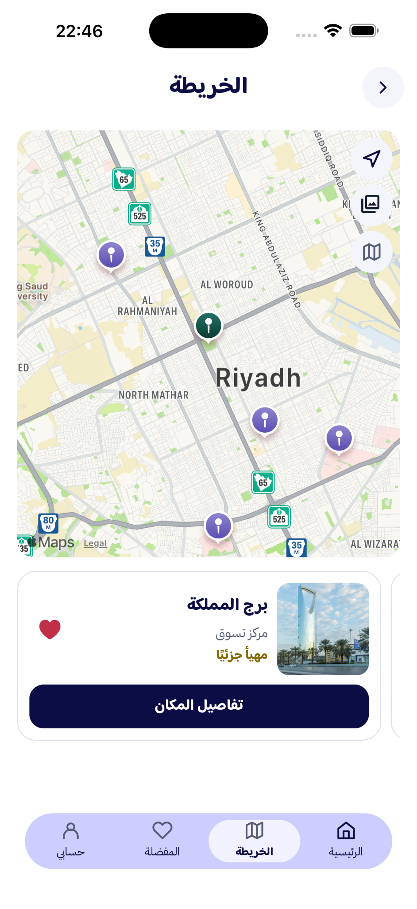
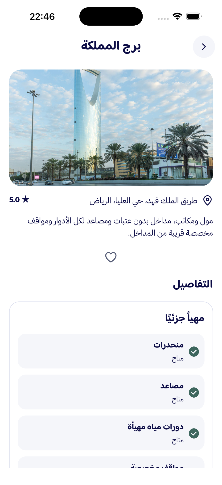
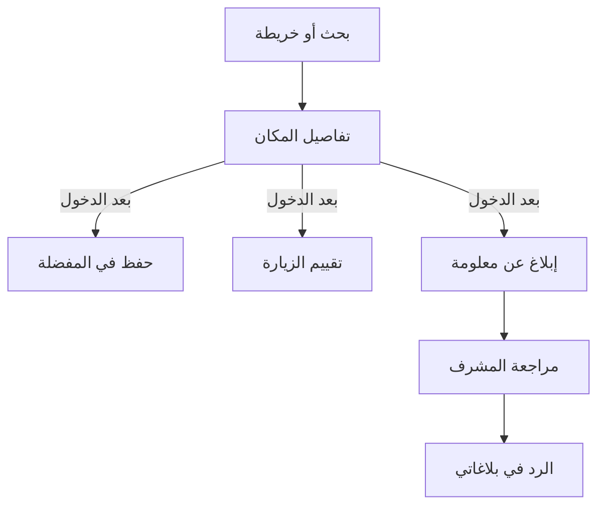

<p align="center"></p>

# عون

**لك في كل مكان عون**

[العربية](README.md) · [English](README.en.md)

[هيكل المستودع](#repository) · [التقنيات](#stack) · [تشغيل المشروع](#run)

**عون دليل لإمكانية الوصول في الأماكن العامة بالرياض**، صمّمناه ضمن مشروع هندسة البرمجيات في جامعة الملك سعود للأشخاص ذوي الإعاقة وكبار السن ومرافقيهم.

تخيّل أنك ترتّب زيارة لبرج المملكة مع شخص يستخدم كرسيًا متحركًا. تعرف العنوان، لكن قبل الخروج تحتاج أن تعرف: هل المدخل بدون درج؟ وهل يوجد مصعد؟ في عون تستطيع اختيار المرافق التي تحتاجها، والعثور على المكان في الخريطة، وقراءة تفاصيل الوصول إليه قبل أن تقرّر زيارته.

## من البحث إلى قرار الزيارة

| فلترة المرافق | الأماكن على الخريطة | تفاصيل برج المملكة |
|---|---|---|
|  |  |  |

في لقطة برج المملكة، تعني عبارة **«مهيّأ جزئيًا»** أن التفاصيل تستحق القراءة: تسجّل صفحة المكان المداخل المهيّأة والمصاعد ضمن المرافق المتاحة، بينما تسجّل لوحات برايل ضمن المرافق غير المتاحة. بعد الزيارة يستطيع العضو مشاركة تجربته أو إبلاغ الفريق عن معلومة تحتاج إلى تصحيح.

<a id="repository"></a>

## هيكل المستودع · Repository structure

هذه أهم مسارات المشروع. لتتبّع ميزة البحث، ابدأ من [شاشة الفلاتر](mobile/app/filters.tsx)، ثم افتح [خدمة الأماكن](mobile/services/places.ts) لمعرفة طريقة تكوين الطلب، و[نقطة دخول FastAPI](backend/main.py) لمعرفة كيف يعيد الخادم النتائج. تعريف الجداول والصلاحيات موجود في [ترحيلات Supabase](supabase/migrations/).

```text
AOUN-APP/
├── mobile/
│   ├── app/
│   │   ├── home.tsx
│   │   ├── filters.tsx
│   │   ├── nearby.tsx
│   │   ├── live-places/[id].tsx
│   │   └── admin/
│   ├── services/
│   │   ├── places.ts
│   │   ├── reports.ts
│   │   └── supabase.ts
│   ├── auth/
│   ├── ui/
│   ├── theme/
│   ├── assets/
│   └── tests/
├── backend/
│   ├── main.py
│   ├── review_photos.py
│   ├── review_photo_cleanup.py
│   └── tests/
├── supabase/
│   ├── migrations/
│   ├── seed.sql
│   └── tests/
├── docs/
│   ├── api.md
│   ├── database.md
│   └── screens/
├── .github/workflows/
├── README.md
└── README.en.md
```

## من يستخدم عون؟

- **الزائر** يتصفح الأماكن بالعربية أو الإنجليزية، ويبحث بالاسم أو المرافق، ويفتح صفحة المكان من القائمة أو الخريطة.
- **العضو** يحفظ الأماكن بالقلب، ويوثّق تجربة الوصول بالنجوم والتعليق والصور. من «حسابي» يستطيع تعديل تقييمه أو حذفه ومتابعة بلاغاته وردّ المشرف.
- **المشرف** يدير الأماكن والحسابات ويراجع التقييمات والبلاغات. عند إغلاق بلاغ يكتب الحل أو سبب الرفض ليطّلع عليه صاحبه.



<a id="stack"></a>

## تقنيات المشروع

| الجزء | الأدوات | مسؤوليته في عون |
|---|---|---|
| تطبيق الجوال | React Native · TypeScript · Expo SDK 54 · Expo Router | عرض الشاشات والتنقّل بين البحث والخريطة وصفحة المكان نفسها. |
| الموقع والخريطة | Expo Location · react-native-maps · Leaflet | تحديد موقع المستخدم وعرض علامات الأماكن على الجوال والويب. |
| واجهة الأماكن والصور | Python · FastAPI · Uvicorn · Pillow | جلب بيانات الأماكن والتحقّق من صور التقييم وإصدار روابط للصور الخاصة. |
| الحسابات والبيانات | Supabase Auth · PostgreSQL · Supabase Storage | تسجيل الدخول وحفظ المفضلة والتقييمات والبلاغات والصور، وتطبيق صلاحيات العضو والمشرف. |

<a id="run"></a>

## التشغيل المحلي

استخدم Python 3.12 وNode.js 22.13 أو أحدث ضمن سلسلة 22. ابدأ من جذر المستودع في كل نافذة طرفية.
```bash
cp -n backend/.env.example backend/.env
cp -n mobile/.env.example mobile/.env
```

جهّز مشروع Supabase للتطوير وطبّق ملفات [الترحيلات](supabase/migrations/) بالترتيب. اضبط عنوان المشروع ومفتاحه العام في ملفّي البيئة بحيث يشيران إلى نفس المشروع. في ملف الجوال اضبط أيضًا `EXPO_PUBLIC_API_URL` على `http://127.0.0.1:8000` لمحاكي iOS. لصور التقييم الخاصة، أكمل إعداد `SUPABASE_REVIEW_PHOTO_SECRET_KEY` و`REVIEW_PHOTO_VALIDATION_KEY` في الباكند فقط. راجع [إعداد الحسابات وروابط الاستعادة](docs/auth-admin.md).

**الطرفية الأولى · الباكند**

```bash
cd backend
python3.12 -m venv .venv
.venv/bin/python -m pip install -r requirements.txt
.venv/bin/python -m uvicorn main:app --reload --port 8000
```

**الطرفية الثانية · محاكي iOS على macOS**

```bash
cd mobile
npm ci
npx expo start --go --ios
```

استخدم نسخة Expo Go متوافقة مع SDK 54 على المحاكي. جرّب [قائمة الأماكن](http://127.0.0.1:8000/places) أو افتح [توثيق API المحلي](http://127.0.0.1:8000/docs).

## التحقق وأدلة التطوير

```bash
(cd mobile && npm run typecheck && node --test tests/*.test.cjs)
(cd backend && .venv/bin/python -m unittest discover -s tests)
```

[دليل التشغيل والأجهزة](docs/setup.md) · [واجهة الأماكن](docs/api.md) · [قاعدة البيانات](docs/database.md) · [الحسابات والإدارة](docs/auth-admin.md)
